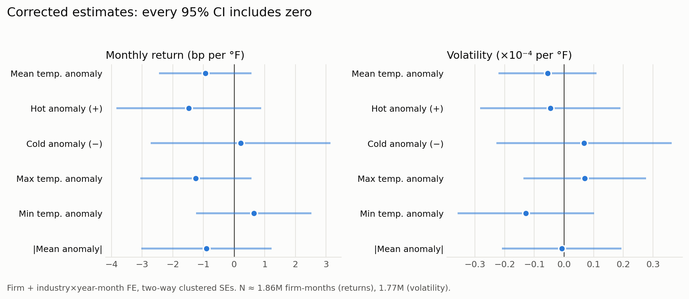
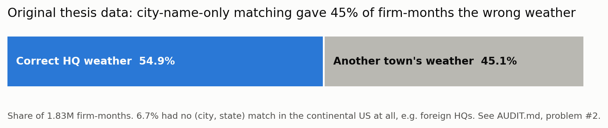
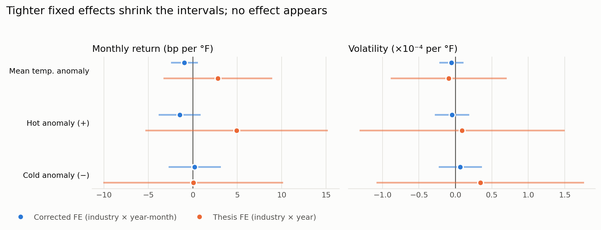

# Warming Trends — temperature anomalies and US stock returns & volatility

A clean, reproducible rebuild of the data and regressions behind
*Warming Trends* (MSc thesis, Utrecht, 2024), plus corrected versions of the
variables found to be wrong. See **AUDIT.md** for what was wrong and why.

## Original thesis

The thesis as submitted in June 2024 is available as a PDF:
[warming-trends-msc-thesis-2024.pdf](https://amir-shokat.github.io/assets/papers/warming-trends-msc-thesis-2024.pdf).
This repository is the later, revised version. It rebuilds the data from the raw downloads, fixes
the problems listed in `AUDIT.md` and redoes the calculations, so its results differ from the PDF:
the original found weak (mostly 10%-level) effects on volatility, the corrected data show none.
This revised version is the one I am building on for future research.

## Key results

After fixing the data problems documented in `AUDIT.md`, temperature anomalies at a firm's headquarters show **no detectable effect** on monthly returns or volatility.

<picture>
  <source media="(prefers-color-scheme: dark)" srcset="output/figures/corrected_effects_dark.png">
  
</picture>

The original thesis data matched weather to firms by city name only:

<picture>
  <source media="(prefers-color-scheme: dark)" srcset="output/figures/data_audit_dark.png">
  
</picture>

With the thesis's coarser fixed effects the estimates are far noisier; tightening them does not reveal an effect:

<picture>
  <source media="(prefers-color-scheme: dark)" srcset="output/figures/thesis_vs_corrected_dark.png">
  
</picture>

Figures are built from `output/tables/` only (`python3 code/09_figures.py`), no data needed.

## Layout

```
warming-trends-replication/
  run_all.sh                 rebuild everything (≈30 min)
  code/
    config.py                all paths and settings (one place to change things)
    01_firms.py              Compustat firm-month sample, HQ city+state, industry, returns
    02_climate.py            PRISM anomalies per location (legacy + corrected)
    03_volatility.py         monthly SD of daily returns (legacy + corrected)
    04_panel.py              merge everything -> panel.parquet
    05_validate_rebuild.py   check rebuild against the thesis's final data file
    06_regressions.py        replicate thesis Tables 2-3; corrected regressions
    07_robustness.py         lags, warmer-period, alternative FE and baselines
    08_latex_tables.py       LaTeX versions of the tables
    09_figures.py            README figures from the result tables
    fe.py                    fixed-effects OLS with two-way clustered SEs
  data/processed/            Parquet outputs (regenerated by the scripts)
  output/tables/             regression tables (CSV + Markdown)
  output/figures/            README figures (light + dark)
  output/logs/               validation report and run logs
  AUDIT.md                   map of the old folder + every problem found
```

## Data

**No data is included in this repository.** Compustat is licensed through WRDS
and may not be redistributed, and the raw files total ~28 GB. To reproduce,
download the inputs below into `data/raw/` (or set `THESIS_RAW_DATA` to their
folder), keeping the file names and sub-folders listed:

| Source | File(s) | Content |
|---|---|---|
| Compustat monthly (WRDS) | `last.csv` | gvkey, iid, date, ticker, trt1m (total return %), exchange, HQ city, NAICS |
| Compustat header | `Climate Data/state.csv` | HQ state |
| Compustat daily (WRDS) | `daily1.csv`, `daily2.csv`, `daily3.csv` | daily close price (unadjusted) |
| PRISM monthly | `Climate Data/{1965 - 1979,…,2010 - 2024}/` | tmean, ppt 1965–2024 |
| PRISM monthly | `Climate Data/min - max/{1995 - 2009,2010 - 2024}/` | tmin, tmax 1995–2024 |
| PRISM normals | `Climate Data/daily/` | 1991–2020 daily normals (tmin, tmean, tmax, ppt) |
| Simplemaps | `uscities.csv` | city, state, lat/lng (= PRISM query points) |
| Market | `Climate Data/SP500 and VIX.csv` | monthly % change S&P 500 and VIX |
| *Optional:* thesis files | `Climate Data/log-return.csv`, `daily_1995-2005.csv`, `daily_2006-2016.csv`, `daily_2017-2024.csv` | the thesis's own intermediate files, used only to compare the rebuild with the thesis (not distributed) |

- **Compustat** — requires a WRDS subscription (most universities have one).
- **PRISM** — free from the PRISM Climate Group, Oregon State University (https://prism.oregonstate.edu).
- **Simplemaps US Cities** (basic, free) — https://simplemaps.com/data/us-cities.

Without the optional thesis files, `run_all.sh` still runs end to end: it skips
the comparison steps (thesis volatility, `05_validate_rebuild.py` and the thesis-table
replication in `06_regressions.py`) and produces all corrected results. All results
in `output/` were produced with the full data and are included so they can be
checked without rerunning.

## Run

```bash
bash run_all.sh
```

Requires Python 3 with pandas, numpy, pyarrow, matplotlib (`pip install -r requirements.txt`). Single steps can be run on their own
(`python3 code/02_climate.py`); each reads the previous step's Parquet output.

## Panel variables (`data/processed/panel.parquet`)

| Column | Meaning |
|---|---|
| `ret`, `ret_w` | monthly log return from trt1m (adjusted); `_w` winsorized 0.5/99.5% |
| `sd`, `sd_w` | SD of daily log returns within the month (corrected); `_w` winsorized |
| `sd_legacy`, `trt1m` | thesis volatility and raw total return, for comparison |
| `tmean_anom_hq` | HQ mean temperature minus trailing 30-yr same-month mean (°F, signed) |
| `hot_hq`, `cold_hq` | positive / negative part of `tmean_anom_hq` |
| `tmax_anom_hq`, `tmin_anom_hq` | tmax / tmin minus PRISM 1991–2020 normal for the month |
| `tmean_absanom_hq` | absolute value of `tmean_anom_hq` (the thesis concept, clean) |
| `ppt_anom_z_hq` | precipitation standardized vs trailing 30-yr same-month mean/SD |
| `*_ex` | the same for the exchange city (New York for 99.9% of firms) |
| `T_*_legacy_*`, `P_legacy_*` | the thesis's original (absolute, buggy) definitions |
| `heat_sensitive` | NAICS 11, 21, 22, 23, 31–33, 48–49 |
| `different_city` | HQ (city, state) ≠ exchange city |
| `hq_in_conus` | HQ (city, state) found in continental US — corrected sample filter |

## Citation

Shokatabadi, A. (2024). *Warming trends: Analyzing the impact of temperature anomalies
on the risk and return of the US stock market* (MSc thesis). Utrecht University.

## License

Code: MIT (see `LICENSE`). Tables and documentation: CC BY 4.0.
Data are not covered and remain subject to their providers' terms.
